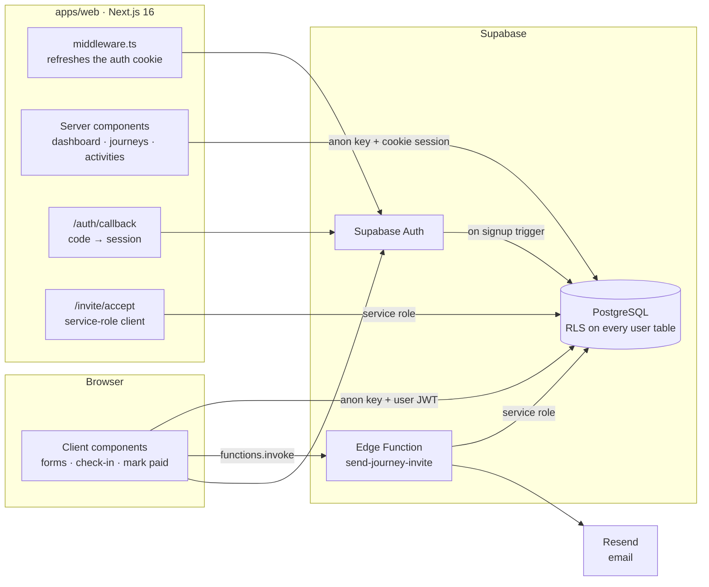
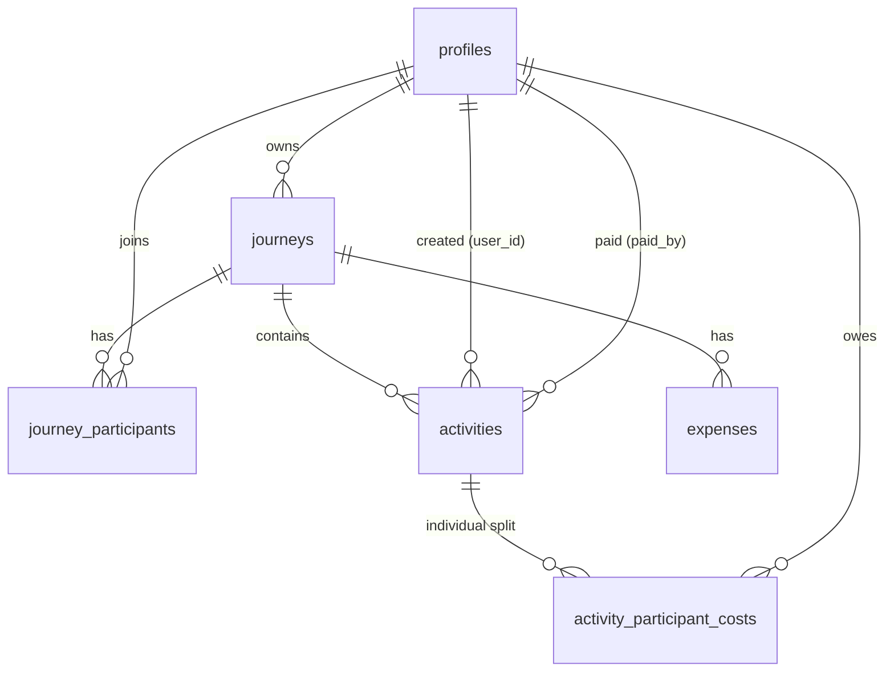
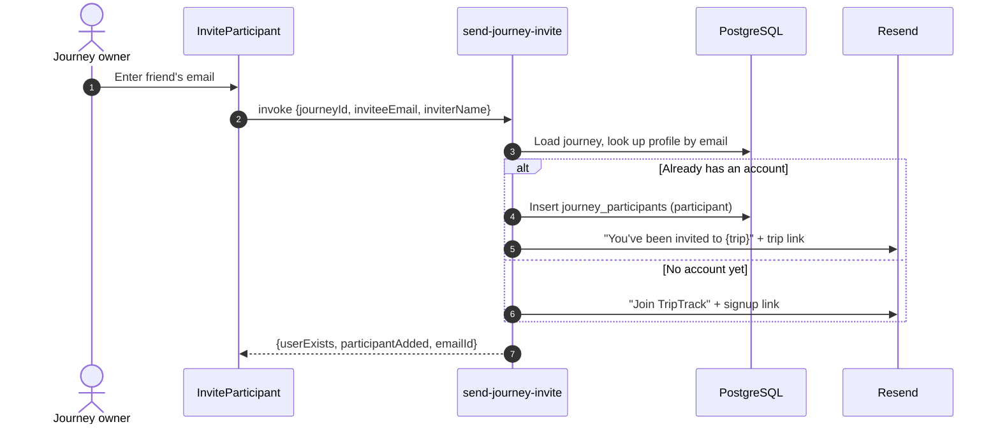

# Architecture

How TripTrack fits together: where the code runs, where the data lives, and what decides who can see it. Setup steps are in the [README](../README.md) and [SETUP.md](../SETUP.md).

## 1. System context

TripTrack has no API server of its own. The Next.js app talks to Supabase directly, and PostgreSQL Row Level Security (RLS) decides what each user can read and write.

| Part | Code | Responsible for |
|---|---|---|
| **Middleware** | `apps/web/src/middleware.ts` | Runs on every page request and calls `auth.getUser()` so an expiring session cookie is refreshed |
| **Server components** | `app/(dashboard)/**/page.tsx` | Read journeys, activities and participants with the user's session. The `(dashboard)` layout redirects to `/login` without one |
| **Client components** | `components/features/*` | Create, edit, delete, check in, and mark paid. They write straight to Supabase with the browser client |
| **Supabase clients** | `lib/supabase/{client,server,admin}.ts` | Browser client, cookie-aware server client, and a service-role client that bypasses RLS |
| **Database** | `supabase-schema.sql`, `supabase/migrations/` | Tables, RLS policies, helper functions and triggers |
| **Edge Function** | `supabase/functions/send-journey-invite` | Adds existing users to a journey and emails the invitation through Resend |

## 2. Data model

| Table | Holds |
|---|---|
| `profiles` | One row per user, created by the `on_auth_user_created` trigger when someone signs up |
| `journeys` | Title, destination, dates, owner (`user_id`) and `currency` (including UGX) |
| `journey_participants` | Membership, with `role` `owner` or `participant`. Unique per journey and user |
| `activities` | Schedule, location, category, check-in state, and cost: `estimated_cost`, `cost_split_type` (`equal`, `individual`, `none`), `split_participants`, `paid_by`, `cost_paid` |
| `activity_participant_costs` | Per-person amounts when an activity uses an `individual` split |
| `expenses` | A general expense table. The main cost flow uses activities instead |

## 3. Who can see what

Access is enforced in PostgreSQL, not in the app. Because the browser holds only the public anon key and the user's own JWT, a user who calls Supabase directly gets exactly what the policies allow.

| Table | Read | Write |
|---|---|---|
| `journeys` | Owner or participant | Owner only |
| `journey_participants` | People on the journey | Owner adds and removes |
| `activities`, `expenses` | Owner or participant of the journey | Anyone on the journey creates; only the creator edits or deletes |
| `activity_participant_costs` | People on the journey | People on the journey |
| `profiles` | Everyone (`USING (true)`), so names can be shown on shared trips | Own row only |

Policies that need to look up membership call `SECURITY DEFINER` helpers such as `is_journey_participant()`. Querying `journey_participants` from inside its own policy would recurse; the helper runs with the definer's rights and breaks the loop.

Two paths bypass RLS with the service-role key, so their checks live in code: the `send-journey-invite` Edge Function and the `/invite/accept` page.

## 4. Inviting someone

`/invite/accept?token=…` is the second half of a token-based flow: it looks up the token in `pending_invites`, requires a signed-in user, adds them as a participant, and deletes the invite.

## 5. Splitting costs

Balances are computed in the browser from the activities already loaded (`JourneyParticipantCostSummary.tsx`). For each activity with a cost:

- **Equal:** divide `estimated_cost` by the number of people in `split_participants`, and charge each of them that share.
- **Individual:** charge each person the amount in `activity_participant_costs`.
- **Payer:** credit the full cost to `paid_by`, or to the activity's creator on older rows where `paid_by` is empty.

Each participant's balance is what they paid minus what they used. A positive balance means they get money back, negative means they owe, and the balances on a journey sum to zero. TripTrack shows these balances but doesn't yet suggest who should pay whom.

## 6. Known limitations

- **Invitations for new users are only half built.** Nothing in this repo writes to `pending_invites`, and the table isn't in `supabase-schema.sql`. A new user gets a signup email but isn't added to the journey after signing up; the owner has to invite them again.
- **Balances are computed client-side.** There's no database view or function for them, so every page that needs balances repeats the calculation over the loaded rows.
- **Amounts are `NUMERIC(10,2)`.** That covers about UGX 99 million per activity, which is enough for trips but not a general-purpose ledger.
- **No offline support, push notifications or receipt uploads** yet.
